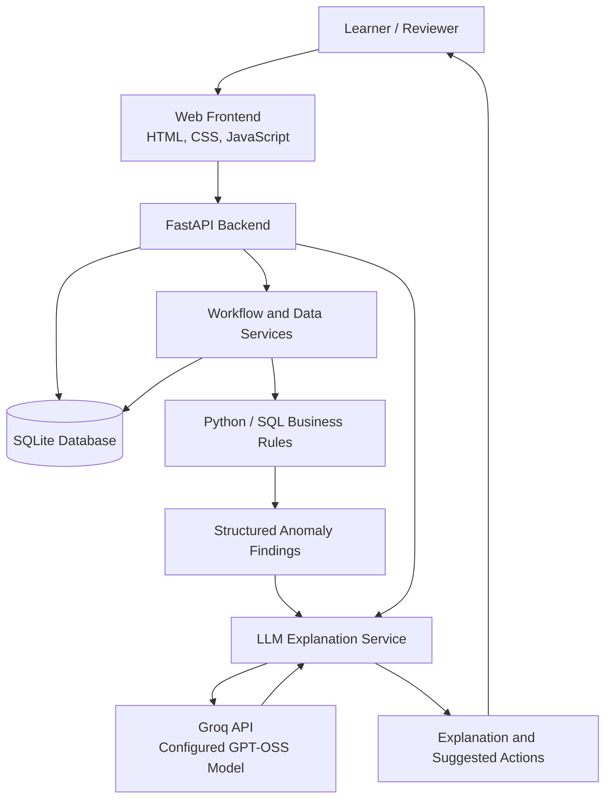

# YottaFlex.ai — Assignment Management & AI-Powered Anomaly Intelligence

A database-driven assignment management system with a Python data pipeline, web application, deterministic anomaly detection, and **LLM-powered explanations that help reviewers understand data-quality and grading issues**.

The project demonstrates how structured data, business rules, workflow validation, and Large Language Models can work together in an educational technology application.

## Table of Contents

- [Project Overview](#project-overview)
- [Problem Statement](#problem-statement)
- [Key Features](#key-features)
- [How the Application Works](#how-the-application-works)
- [AI Integration — Key Highlight](#ai-integration--key-highlight)
- [System Architecture](#system-architecture)
- [Technology Stack](#technology-stack)
- [Database Design](#database-design)
- [Synthetic Dataset](#synthetic-dataset)
- [Project Structure](#project-structure)
- [Installation and Setup](#installation-and-setup)
- [Running the Application](#running-the-application)
- [Validation and Testing](#validation-and-testing)
- [Security and Responsible AI](#security-and-responsible-ai)
- [Limitations and Future Improvements](#limitations-and-future-improvements)
- [Author](#author)

---

## Project Overview

YottaFlex.ai is an assignment management and data-quality intelligence project designed around the lifecycle of educational assignments.

The system models how courses and learners are connected through enrollments, how assignments are submitted and graded, how feedback and resubmissions are handled, and how appeals and grade revisions are recorded.

Alongside the data pipeline, the project includes a web application for interacting with assignment workflows and an AI assistant that explains detected anomalies.

The application has three main components:

1. **Assignment management:** Supports learner submissions and associated grading, feedback, resubmission, and appeal workflows.
2. **Data integrity and anomaly detection:** Uses Python and SQL-based business rules to identify inconsistent or suspicious records.
3. **AI-powered explanations:** Uses a Large Language Model through the Groq API to explain detected issues in natural language and suggest actions for human review.

The objective is to demonstrate an end-to-end application that combines relational data modeling, backend development, data validation, workflow management, and practical LLM integration.

## Problem Statement

Assignment-management systems maintain interconnected records about learners, courses, assignments, submissions, grades, rubrics, and appeals. Inconsistent data or incorrectly applied business rules can affect grading accuracy and make reviews difficult.

Examples include:

- A learner submitting an assignment without the required course enrollment.
- A score exceeding the maximum allowed by a grading rubric.
- A late penalty being applied more than once.
- An appeal or grade revision lacking the expected audit history.

Traditional database queries and validation rules can identify these issues, but their results may not always be easy for a reviewer to interpret quickly.

This project addresses both aspects:

- Deterministic validation identifies records that violate explicitly defined rules.
- An LLM-powered explanation layer translates detected findings into understandable descriptions and suggested investigative steps.

This separation preserves the reliability of business-rule checks while making their results more accessible to reviewers.

## Key Features

### 1. Course and learner management

The relational data model represents courses, learners, and enrollment relationships.

Enrollments connect learners to the courses in which they participate. These relationships are important when validating whether a learner is eligible to submit an assignment associated with a course.

### 2. Assignment lifecycle management

The application models the major stages of an assignment workflow:

- Assignment publication and associated course relationships.
- Learner submission records and submission artifacts.
- Rubric-based grading and criterion scores.
- Feedback associated with submissions and grades.
- Resubmission requests and approval workflows.
- Appeals and grade revisions.
- Audit events for relevant workflow changes.

The database provides the foundation for connecting these records and checking their consistency.

### 3. Deterministic anomaly detection

The Python anomaly detection engine evaluates records using explicit business rules and SQL queries.

The project includes four predefined anomaly scenarios:

| Anomaly | What it represents |
|---|---|
| Unenrolled learner submission | A learner submits work without the expected enrollment in the associated course. |
| Grade exceeds rubric maximum | A score exceeds the maximum permitted by the rubric. |
| Duplicate late penalty | A late penalty is applied more than once. |
| Appeal without audit history | An appeal lacks the expected audit event or history. |

These scenarios are intentionally injected into the synthetic dataset to test detection behavior. They are test cases, not claims about actual incidents in a production system.

### 4. Grading, feedback, and appeals

Grades are associated with assignment submissions and rubric-related records. Feedback provides information about a graded submission, while resubmission requests and appeals represent later stages of the workflow.

Grade revisions and audit events help preserve the history needed to inspect changes and validate workflow consistency.

### 5. LLM-powered anomaly explanation

The AI assistant provides a natural-language explanation layer for detected issues. It helps reviewers understand what a finding means, why it may matter, and what evidence to check next.

**The LLM explains findings; deterministic Python rules remain responsible for anomaly detection.**

More details are provided in the [AI Integration](#ai-integration--key-highlight) section.

### 6. Data generation and export

The pipeline supports reproducible synthetic-data generation, anomaly injection, validation, inspection, and export.

Supported export formats include CSV, JSON, and SQL, allowing records to be inspected and used for further analysis.

### 7. Database and workflow validation

The project includes validation scripts for baseline record counts, foreign-key integrity, grade constraints, enrollment consistency, workflow relationships, and predefined anomaly scenarios.

These checks make it possible to verify expected behavior instead of relying only on manual inspection.

---

## How the Application Works

The project combines a data pipeline with an interactive web application. The following sequence describes the main processing flow.

### Step 1 — Prepare the educational data

The pipeline creates a relational dataset containing courses, learners, enrollments, assignments, rubrics, submissions, grades, feedback, and workflow history.

A fixed random seed supports reproducible synthetic-data generation.

### Step 2 — Store and connect records

SQLite stores the structured records. Primary keys and foreign keys connect related entities and support referential-integrity checks.

For example, a submission references an assignment and a learner, while enrollment records establish the learner-course relationship.

### Step 3 — Process assignment workflows

The web application provides an interface for interacting with supported assignment workflows.

Depending on the operation, records can represent submissions, grading and feedback, resubmission requests, appeals, and related audit events.

The application uses its backend to communicate with the database rather than relying on the frontend to perform database operations directly.

### Step 4 — Validate the data

Validation scripts check the expected baseline dataset counts and relevant integrity constraints.

Workflow validation checks relationships among resubmissions, appeals, revised grades, and audit events.

### Step 5 — Detect anomalies

The Python detection engine evaluates records against explicit business rules. When a rule is violated, the detector produces a finding for review.

This is a deterministic process: the detection decision does not depend on an LLM's opinion.

### Step 6 — Explain findings using the LLM

When the AI assistant is used, the application sends the relevant request and context to the configured language model through the Groq API.

The model generates a human-readable explanation and suggested investigative actions. The explanation is supplementary to the underlying finding and should be checked against the original data.

### Step 7 — Review and investigate

A reviewer can use the finding, related records, and AI-generated explanation to decide what needs further investigation.

The LLM does not independently authorize grade changes or replace the application's validation rules.

---

## AI Integration — Key Highlight

The LLM integration is a major feature of this project because it demonstrates a practical use of generative AI within a structured, rule-based application.

Rather than asking a language model to inspect an entire database and decide what is wrong, the application separates **finding an anomaly** from **explaining an anomaly**.

### AI technology

| Component | Implementation |
|---|---|
| LLM provider | Groq API |
| Configured model | `openai/gpt-oss-20b` |
| Python integration | Groq Python SDK |
| Application integration | FastAPI backend |
| Configuration | Environment variables |
| Primary purpose | Natural-language anomaly explanations and reviewer assistance |

The model identifier specifies the configured model accessed through Groq; it does not mean the model is hosted locally by this application.

### How the AI assistant works

**1. A business-rule violation is detected.**

For example, Python identifies a grade that exceeds the configured rubric maximum.

**2. The application prepares the relevant context.**

The AI explanation request uses the relevant question and application context to help the model understand the finding.

**3. The LLM generates an explanation.**

The model turns the technical finding into a clearer description that a reviewer can understand.

**4. The model suggests investigative steps.**

Depending on the context, these may include checking the rubric configuration, criterion-level scores, grading records, or related workflow history.

**5. A human reviewer evaluates the result.**

The explanation supports investigation; the reviewer must verify the underlying records before making a decision.

### Example: A grade exceeding the rubric maximum

Imagine an assignment has a maximum permitted score of 100, but a stored score is 110.

The application separates the responsibilities as follows:

| Layer | Responsibility |
|---|---|
| Python and SQL rules | Identify that the score exceeds the permitted maximum. |
| LLM explanation layer | Explain the discrepancy and suggest relevant checks. |
| Human reviewer | Inspect the evidence and decide whether a correction is necessary. |

An example of the type of explanation the assistant can provide is:

> The recorded score exceeds the rubric's maximum permitted value. Review the rubric configuration, criterion-level scores, and grading records to determine whether the issue is caused by an incorrect score, a configuration mismatch, or another data inconsistency.

This example illustrates the intended behavior; the exact response depends on the request and context provided to the model.

### Why this design matters

- **Reliability:** Business-rule decisions remain explicit and reproducible.
- **Explainability:** Reviewers receive a readable explanation instead of only a technical finding.
- **Human oversight:** Suggested actions do not automatically become approved changes.
- **Separation of concerns:** Detection and explanation can be tested and improved independently.
- **Practical AI integration:** The LLM is connected to an existing application workflow rather than being used as a standalone chatbot without domain context.

### Configuration

The model and API key are configured through environment variables. This allows credentials to remain outside the source code.

The AI feature requires a valid Groq API key, network connectivity, and access to the configured model. The rest of the local application may still run when the AI service is unavailable, depending on the operation being used.

---

## System Architecture

The following diagram shows the conceptual relationship between the main components.



The diagram represents the intended separation of responsibilities. The exact request path depends on the endpoint and workflow being used.

The core components are:

- **Frontend:** Presents the application's interface and sends requests to the backend.
- **FastAPI backend:** Handles supported application endpoints and coordinates operations.
- **SQLite:** Persists the relational records.
- **Business-rule layer:** Performs deterministic validation and anomaly detection.
- **LLM service:** Produces natural-language explanations through the Groq API.
- **Reviewer:** Uses the findings and explanations to guide further investigation.

---

## Technology Stack

| Area | Technologies |
|---|---|
| Programming language | Python |
| Web backend | FastAPI, Uvicorn |
| Frontend | HTML, CSS, JavaScript |
| Database | SQLite |
| Data access and validation | Python, SQL |
| AI integration | Groq API, Groq Python SDK |
| Language model | GPT-OSS 20B, accessed through Groq |
| Data formats | CSV, JSON, SQL |
| Automated testing | pytest and the project's validation scripts |
| Additional interface modules | Streamlit and Python UI modules |
| Development and version control | VS Code, Git, GitHub |

The original data pipeline uses Python's standard library for its core data-generation and SQLite operations. The web and AI components require their respective additional dependencies, listed separately in the project's requirements files.

---

## Database Design

The relational data model represents the main entities in the assignment lifecycle.

| Entity | Purpose |
|---|---|
| Courses | Represents the courses associated with assignments and learner participation. |
| Learners | Stores learner records. |
| Enrollments | Connects learners with courses. |
| Assignments | Represents assignments associated with courses. |
| Rubrics | Represents grading rubrics. |
| Rubric criteria | Defines individual grading criteria and their limits. |
| Submissions | Records learner attempts to submit assignments. |
| Submission artifacts | Stores artifact metadata associated with submissions. |
| Grades | Records grading results and revisions. |
| Grade criterion scores | Represents scores associated with individual rubric criteria. |
| Feedback | Stores grading feedback. |
| Resubmissions | Records resubmission requests and associated workflow state. |
| Appeals | Represents grade appeals and their review workflow. |
| Audit events | Records relevant workflow and grade-change history. |
| Validation issues | Supports recording or inspecting data-quality findings. |

The schema uses keys and relationships to connect these entities. The data dictionary and SQL schema provide further implementation details.

---

## Synthetic Dataset

The original data pipeline uses a fixed random seed of `20261022` to support reproducible generation.

The expected baseline dataset is:

| Entity | Expected baseline count |
|---|---:|
| Courses | 50 |
| Learners | 10,000 |
| Assignments | 1,000 |
| Original submissions | 30,000 |
| Original submission artifacts | 30,000 |
| Original grades | 30,000 |
| Original feedback records | 30,000 |

These figures describe the baseline generated dataset, not necessarily the final database totals. The final database can also contain workflow records, injected anomalies, and additional submissions created through the web application.

The validator distinguishes the baseline records from known injected anomaly and website-created submission records when checking the baseline submission count.

The dataset is synthetic and intended for development, validation, and demonstration.

---

## Project Structure

```text
yottaflex-assignment-management/
├── app.py
├── src/
│   ├── database.py
│   ├── schema.sql
│   ├── main.py
│   ├── generate_data.py
│   ├── generate_workflows.py
│   ├── inject_anomalies.py
│   ├── detect_anomalies.py
│   ├── inspect_anomalies.py
│   ├── app_queries.py
│   ├── export_data.py
│   ├── check_database.py
│   ├── validate_data.py
│   └── validate_workflows.py
├── webapp/
│   ├── main.py
│   └── static/
│       ├── index.html
│       ├── styles.css
│       └── app.js
├── ui/
│   ├── staff.py
│   └── student.py
├── tests/
├── docs/
│   └── data_dictionary.md
├── exports/
├── requirements.txt
├── requirements-web.txt
├── README.md
└── README_WEBAPP.md
```

The tree highlights the main application files. Additional files may exist in the repository.

---

## Installation and Setup

These instructions are for running the project locally on a development computer.

### Prerequisites

- Python 3.8 or a compatible version supported by the dependencies.
- Git, for cloning the repository.
- A Groq API key, if you want to use the LLM explanation feature.

### 1. Clone the repository

```bash
git clone https://github.com/Hema5430/yottaflex-assignment-management.git
cd yottaflex-assignment-management
```

### 2. Create and activate a virtual environment

On Windows PowerShell:

```powershell
python -m venv .venv
.\.venv\Scripts\Activate.ps1
```

If PowerShell blocks activation, follow your local environment's execution-policy guidance or invoke the virtual environment's Python executable directly.

### 3. Install the dependencies

Install the base requirements:

```powershell
python -m pip install -r requirements.txt
```

Install the additional web application requirements:

```powershell
python -m pip install -r requirements-web.txt
```

Use the requirements files as the source of truth for the packages and versions needed by the project.

### 4. Configure the environment variables

Create a `.env` file in the project root for local development:

```env
GROQ_API_KEY=your_groq_api_key
GROQ_MODEL=openai/gpt-oss-20b
```

Replace the placeholder with your own key. Never commit `.env` or publish API credentials.

### 5. Prepare the database

Follow the instructions in `README_WEBAPP.md` and inspect the database utilities in `src/` to understand the expected initialization process.

If you need to regenerate the synthetic dataset, start from a fresh or backed-up database and review the generation and anomaly-injection scripts first. Do not assume that generation or injection is safe to repeat against an existing database.

---

## Running the Application

### Start the web application

From the project root, with the virtual environment active:

```powershell
python -m uvicorn webapp.main:app --reload
```

When the server starts successfully, open the local application in your browser.

| Resource | Local URL |
|---|---|
| Web application | http://127.0.0.1:8000 |
| API documentation | http://127.0.0.1:8000/docs |
| Health endpoint | http://127.0.0.1:8000/api/health |
| AI configuration status | http://127.0.0.1:8000/api/ai/status |

These addresses are for local development. They are not public deployment links and normally work only on the machine running the application.

The AI assistant requires the relevant API configuration and access to the Groq service. The health and AI-status endpoints help inspect the local application's state.

### Run the Streamlit interface

The repository also contains a Streamlit entry point and Python UI modules. If you want to run that interface and its dependencies are installed, use:

```powershell
python -m streamlit run app.py
```

The Streamlit interface and the FastAPI website are separate application entry points. Follow `README_WEBAPP.md` for any additional details specific to the web application.

---

## Validation and Testing

Run the baseline data-integrity validator:

```powershell
python -m src.validate_data
```

Run workflow validation:

```powershell
python -m src.validate_workflows
```

Run the automated test suite:

```powershell
python -m pytest -q
```

The original project also documents the standard-library test runner:

```powershell
python -m unittest discover -s tests -v
```

Use the test runner supported by the tests and dependencies installed in your environment.

The validation process checks baseline record counts, foreign-key integrity, grade constraints, enrollment consistency, workflow relationships, and predefined anomaly scenarios. The automated tests provide additional checks of the implementation.

---

## Security and Responsible AI

The project is a demonstration application and should not be treated as a production-ready academic platform.

- Keep API keys in environment variables and out of source control.
- Do not expose real learner records or sensitive exports in a public repository.
- Treat LLM explanations as advisory rather than authoritative.
- Verify findings against the database and business rules before taking action.
- Do not allow an LLM-generated recommendation to automatically authorize a grade change.
- The demonstration role switch is not a substitute for production authentication and authorization.

The separation between deterministic detection and LLM-generated explanations is intentional: the application retains explicit business rules while using generative AI to improve how findings are communicated.

## Limitations and Future Improvements

The current project focuses on demonstrating assignment workflows, relational data integrity, rule-based anomaly detection, and LLM-assisted explanations.

Potential next steps include:

- Production-grade authentication and role-based access control.
- Broader API and end-to-end tests.
- Improved handling of API failures, timeouts, and rate limits.
- Structured AI outputs and clearer evidence references.
- Reviewer feedback to evaluate explanation quality.
- More comprehensive audit logging and monitoring.
- Deployment with appropriate secret management, privacy controls, and operational safeguards.

## Author

**Hema Sri**

GitHub: [Hema5430](https://github.com/Hema5430)

---

*This project demonstrates the integration of relational data modeling, Python automation, deterministic business-rule validation, web application development, and LLM-powered assistance for human reviewers.*
